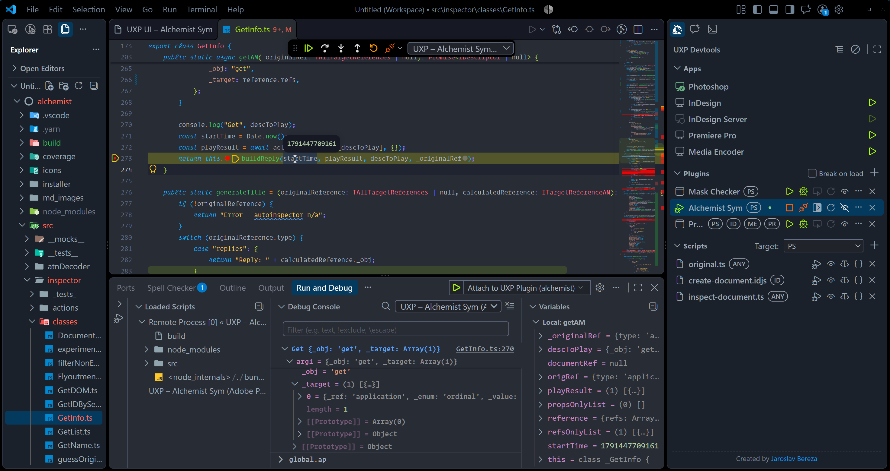
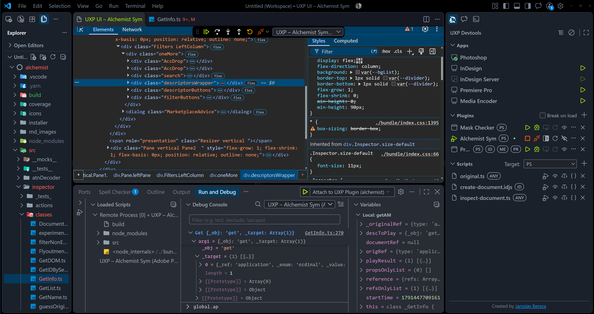
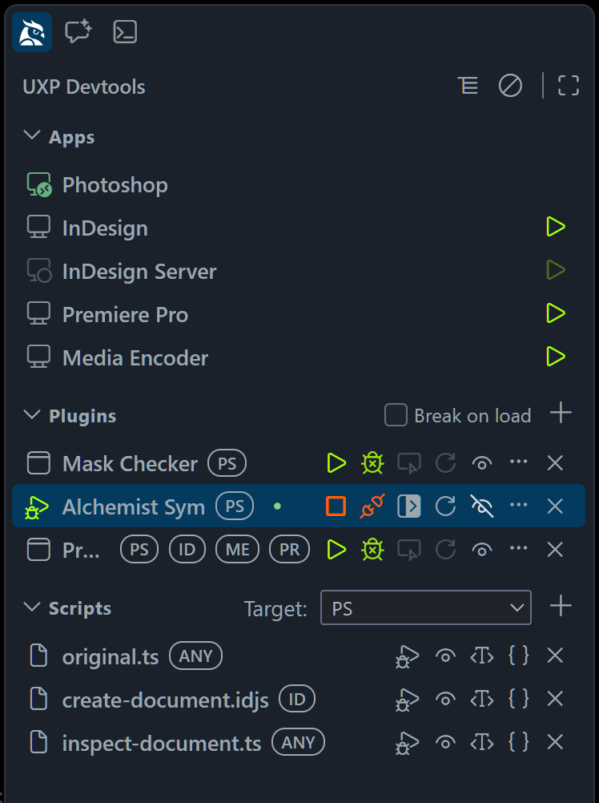

# UXP Debugger – VS Code Extension

[#StandWithUkraine 🇺🇦](https://github.com/vshymanskyy/StandWithUkraine/blob/main/docs/README.md)

Load, reload and debug **Adobe UXP plugins and scripts** (Photoshop, InDesign, Premiere Pro, Media Encoder) directly from VS Code — with full source-map support and **no Adobe UXP Developer Tools (UDT) required**.

The extension hosts its own UDT-compatible service broker inside VS Code and announces it to Adobe applications over Vulcan IPC. Host applications connect straight to VS Code, which then loads your plugin and tunnels the Chrome DevTools Protocol to the built-in JS debugger.

| Debugging a plugin |
| --- |
| [](docs/images/debugger-preview-1.png) |
| Inspecting a plugin user interface |
| [](docs/images/debugger-preview-2.png) |

---

## Video tutorial

[](https://www.youtube.com/watch?v=_f5EdNuN7YQ)

Watch on YouTube: <https://www.youtube.com/watch?v=_f5EdNuN7YQ>

---

## Requirements

- **VS Code** 1.99 or newer (desktop; Windows x64, macOS x64, or macOS Apple silicon)
- An Adobe host application with UXP support: **Photoshop 23.2+**, **InDesign 18.5+**, **Premiere Pro 25.6+**, or **Media Encoder 27.0+**
- **Adobe UXP Developer Tools app is NOT needed** — close it if it is running (it occupies port 14001)
- Administrator rights once, to enable Adobe's machine-global developer mode (see below)

---

## Getting started

1. **Install the extension** from the VS Code Marketplace (search for **UXP Debugger**).
2. **Open your plugin project** and open its `manifest.json` in the editor.
3. Open the **UXP Devtools** panel (Activity Bar) and use **Add Plugin**
   (or **Add active manifest**, using the file open in the editor).
4. **Start your Adobe application** (e.g. Photoshop).
5. Run **`UXP: Load Plugin`**.
6. _On first use the extension checks the machine-global **developer mode** flag. If it is missing you get a consent dialog followed by an OS elevation prompt same as UDT does. So if you used UDT before you will never see that dialog._
7. Click **Debug** for the plugin in the UXP Devtools panel and set breakpoints.

> Tip: clicking **Debug** for an unloaded plugin offers **"Load and attach"** — steps 5 and 6 in one go.

---

## Control panel (sidebar)

The **UXP Devtools** icon in the Activity Bar opens a sidebar panel — the UDT-style
home for day-to-day app launch, plugin and script registration, lifecycle actions,
debugging, inspection, Watch, and packaging. Its global registry is independent of the
current workspace, and every Command Palette entry below remains available. See
[Control Panel](docs/CONTROL-PANEL.md) for the complete behavior and
[App Discovery and Launch](docs/APP-DISCOVERY.md) for host status and startup.

<!-- markdownlint-disable-next-line MD033 -->
<a href="docs/images/debugger-panel.png"></a>

## GitHub Copilot and agent tools

The extension contributes VS Code language-model tools so compatible agents can discover,
operate, and inspect UXP development sessions. Start with `uxp_get_debug_state`; see
[Language Model Tools](docs/LANGUAGE-MODEL-TOOLS.md) for the complete tool reference,
confirmation policy, and workflows.

## Build-tool hooks

Build pipelines can trigger load, unload, refresh, full reload, watch, and pack operations
through localhost HTTP hooks on the broker's existing port. See
[Build-Tool REST Hooks](docs/BUILD-TOOL-HOOKS.md) for endpoints and examples.

## Documentation

- [Architecture and implementation record](docs/UXP-DEBUGGER-ARCHITECTURE.md) — system
  boundaries, protocol, decisions, measured evidence, constraints, and error model.
- [App discovery and launch](docs/APP-DISCOVERY.md) — startup, Developer Mode, broker
  states, installation detection, and manual host launch.
- [Control panel](docs/CONTROL-PANEL.md) — sidebar UI, registry, actions, Watch, persistence,
  webview protocol, and tests.
- [Break on start](docs/BREAK-ON-START.md) — debugger handshake, script timing limits,
  diagnostics, and rejected approaches.
- [HTML/CSS inspector](docs/UI-DEBUGGING.md) — DevTools frontend, CDP multiplexing, safety,
  and lifecycle.
- [Multi-window takeover](docs/MULTI-WINDOW-TAKEOVER.md) — exclusive broker ownership and
  handoff protocol.
- [Build-tool REST hooks](docs/BUILD-TOOL-HOOKS.md) and
  [Language Model Tools](docs/LANGUAGE-MODEL-TOOLS.md) — external build and agent entry points.

---

## Commands

| Command | What it does |
| --- | --- |
| `UXP: Load Plugin` | Validates and loads a registered plugin into one selected compatible app |
| `UXP: Load Plugin (Break on Start)` | Loads a plugin and pauses it until the debugger attaches |
| `UXP: Unload Plugin` | Unloads a live plugin session |
| `UXP: Reload Plugin` | Reloads a live session (an attached debugger survives the reload) |
| `UXP: Inspect Plugin UI (HTML/CSS)` | Opens the DevTools Elements panel (DOM + CSS) for a live plugin session |
| `UXP: Debug Current Script` | Runs + debugs the `.ccjs` / `.psjs` / `.idjs` / `.js` / `.ts` file in the active editor |
| `UXP: Pack Plugin…` | Packages a registered plugin as a `.ccx` archive |
| `UXP: Enable Developer Mode` | Writes Adobe's developer-mode flag (consent + elevation) |
| `UXP: Start UXP Devtools` | Starts the built-in broker |
| `UXP: Stop UXP Devtools` | Stops the built-in broker |
| `UXP: Enable Compact View` | Switches the panel to its compact layout |
| `UXP: Disable Compact View` | Restores the full panel layout |

---

## launch.json (optional)

Attach to a plugin with **F5**:

```json
{
  "type": "uxp",
  "request": "attach",
  "name": "Attach to UXP Plugin",
  "manifestPath": "${workspaceFolder}/manifest.json"
}
```

Run + debug a script:

```json
{
  "type": "uxp-script",
  "request": "launch",
  "name": "Debug UXP Script",
  "script": "${file}",
  "app": "PS",
  "userArgs": [1920, 1080, { "keepRatio": true }]
}
```

`app` is optional and restricts execution to one host app id (`PS`, `ID`, `premierepro`);
without it you are asked to pick when several compatible apps are connected. The script's
file extension always decides which apps are compatible (see
[Script debugging notes](#script-debugging-notes)); `app` can only narrow that set.
Use the **Create launch.json configuration** button on a plugin (`…` menu) or script row in the
UXP Devtools panel to generate these entries with the known values filled in.

---

## Script debugging notes

Supported extensions are `.ccjs`, `.psjs`, `.idjs`, `.js`, and `.ts`.

**Target app selection.** The file extension decides which host apps may run the script:

- `.js`, `.ts`, and `.ccjs` run in any connected UXP host app.
- `.psjs` runs only in Photoshop and `.idjs` only in InDesign.

The target (`app` in `launch.json`, `appId` in the `uxp_debug_script` tool, or the target-app
selector in the panel) never overrides the extension. It only narrows the compatible apps
further, so it is meaningful for `.js`, `.ts`, and `.ccjs`. A target that conflicts with the
extension (e.g. `.psjs` with `app: "ID"`) matches no app and is reported as "host app not
running".

Script arguments are
comma-separated JSON values or `userArgs` in `launch.json`. The panel workflow and `.ts`
type-erasure limits are documented in [Control Panel](docs/CONTROL-PANEL.md#4-scripts-section);
the short-script attach race and workaround are documented in
[Break on start](docs/BREAK-ON-START.md#command-level-flow-context).

## Source maps & breakpoints

Breakpoints in your original TypeScript/JavaScript sources work out of the box:

- **Inline and external source maps are both supported** — your bundler can emit either an **inline** map (e.g. webpack `devtool: "inline-source-map"`, esbuild/Vite `sourcemap: "inline"`) or an **external `.map` file** next to the bundle referenced via `//# sourceMappingURL=`.
- **Unbundled plain `.js` and standalone `.ts` scripts work without a bundler** — for scripts without a source map, the CDP proxy automatically synthesizes a 1:1 identity source map once it matches the runtime script to a file on disk; standalone `.ts` scripts are type-stripped in place with an inline identity map.
- **Automatic path resolution** — when UXP parses a script, the CDP proxy resolves every `sources` entry against your plugin directory, up to 5 ancestor directories (stopping at `.git`), and their immediate subdirectories, rewriting matched sources to canonical `file:///` URLs (and inlining external `.map` files) before handing the event to VS Code's JS debugger.

## HTML/CSS inspector

`UXP: Inspect Plugin UI (HTML/CSS)` opens the bundled Chrome DevTools **Elements** panel
for a live plugin session. See [HTML/CSS Inspector](docs/UI-DEBUGGING.md) for capabilities,
limitations, CDP routing, lifecycle, and maintenance.

---

## Troubleshooting

| Symptom | Cause | Fix |
| --- | --- | --- |
| _"Port 14001 is already in use"_ | Adobe UXP Developer Tools (or an old `uxp service`) is running | Close it and hit **Retry** |
| `"<App> is not running or not connected"` | Host app not started, or connected before the broker existed | Start (or restart) the app, wait a few seconds, **Retry** |
| _"Developer mode could not be enabled"_ | Elevation prompt declined | Run `UXP: Enable Developer Mode` again and accept the prompt |
| _"Plugin load timed out"_ | Host app busy or showing a modal dialog | Dismiss dialogs in the app and **Retry** |
| _"…is a sandboxed host application"_ | UWP-style host (not supported yet) | Use a non-sandboxed host app |
| Breakpoints not binding (hollow gray circle) | Debugger not attached, stale build, missing source maps, or unresolved source paths | Follow [Why is my breakpoint not binding?](#why-is-my-breakpoint-not-binding) below |
| _"None of the connected applications report script-debugging support"_ | Older UXP runtime | Update the host app, or use **Try anyway** |

The **UXP Debugger** output channel contains detailed diagnostics; each host app also gets its own `UXP – <App> <version>` log channel.

### Why is my breakpoint not binding?

When a breakpoint stays hollow/gray (_"Unbound breakpoint"_) or is never hit, work through the causes below from the simplest everyday oversights to the most complex source-map and timing issues:

1. **The debugger is not attached (or is attached to a different session)**
   - Clicking **Load** (or running `UXP: Load Plugin`) only loads the plugin into the host app — it does **not** start a VS Code debug session. Click **Debug** on the plugin row in the **UXP Devtools** panel (or press **F5** with a `"type": "uxp"` configuration) and confirm the VS Code debug toolbar is visible.
   - If you have multiple plugins or multiple Adobe host apps connected, verify in the **Call Stack** view (or the **UXP Devtools** panel) that the active debug session is attached to the plugin and host app you are actually interacting with.

2. **The breakpoint is on a non-executable line, or the build/plugin is stale**
   - Breakpoints placed on TypeScript `interface` / `type` declarations, comments, blank lines, or dead code eliminated by tree-shaking have no generated JavaScript instructions to bind to. Try placing the breakpoint on a concrete statement (e.g. `console.log(...)`).
   - If you edited your source files without rebuilding, or rebuilt without refreshing the plugin, the running UXP session still has the old bundle. Rebuild your bundle and click **Refresh** / **Reload** (or enable **Watch** on the plugin row).

3. **The script or chunk has not been parsed by UXP yet**
   - VS Code's JS debugger can only bind a breakpoint after UXP actually loads and parses the script containing that code (`Debugger.scriptParsed`).
   - If the file is never imported from your entry point, or lives in a lazy-loaded chunk (`import()`), a secondary HTML dialog/panel that has not been opened yet, or a Web Worker, the breakpoint will remain unbound until that code path is loaded at runtime.

4. **Top-level startup code already ran before the debugger attached (or a short script finished first)**
   - **Plugins:** If your breakpoint is inside top-level initialization code that runs immediately when the plugin loads, attaching the debugger *after* a normal load is too late — that code has already executed. Check **Break on load** in the **UXP Devtools** panel header (or run `UXP: Load Plugin (Break on Start)`) and then click **Debug** so the runtime pauses before executing the bundle.
   - **Standalone scripts (`.js`, `.ts`, `.ccjs`, `.psjs`, `.idjs`):** Very short synchronous scripts can finish executing before VS Code finishes attaching and processing the source map. Add a short initial async pause at the top of the script while debugging:

     ```js
     await new Promise((resolve) => setTimeout(resolve, 1500));
     ```

   See [Break on start](docs/BREAK-ON-START.md) for the full startup handshake details.

5. **Your bundler is not emitting source maps (or uses `eval` devtool modes)**
   - If your build pipeline transpiles TypeScript/JSX or bundles modules without emitting a source map, UXP only sees the compiled `.js` file and the debugger never learns about your original `.ts` / `.tsx` files.
   - Enable **inline** source maps (webpack: `devtool: "inline-source-map"`, esbuild/Vite: `sourcemap: "inline"`) or **external** `.map` files (webpack: `devtool: "source-map"`, esbuild/Vite: `sourcemap: true`).
   - Avoid webpack's `eval` or `eval-cheap-*` modes — `eval()` strings do not carry a script-level `sourceMapURL` on `Debugger.scriptParsed` and lack accurate source mappings.
   - If you use external `.map` files, make sure your build copies the `.js.map` file into the deployed plugin folder right next to the `.js` bundle referenced by `manifest.json`.

6. **Inspect the `UXP Debugger` Output panel to see which source maps and files resolved on disk**
   - Open VS Code's **Output** panel (`Ctrl+Shift+U` / `Cmd+Shift+U`) and select **UXP Debugger** from the channel dropdown.
   - Whenever a debug session starts or a script is parsed, the CDP proxy logs how each runtime script and its source-map `sources` entries were matched to local files on disk:
     - **Script match:**

       ```text
       [CDP] Script: "uxp://..." → "file:///.../dist/index.js"
       ```

       Confirms the runtime script URL was matched to a local `.js` file in your plugin folder.
     - **Missing or invalid source map:**
       - `[CDP] Source map not found: index.js.map` — the bundle has a `//# sourceMappingURL=...` comment, but the `.map` file could not be found next to the script on disk.
       - `[CDP] Failed to rewrite source map: ...` — the inline or external source map could not be decoded or is not valid Source Map v3 JSON.
     - **Which source files were found on disk and which were not:**

       ```text
       [CDP] Source: "webpack://my-plugin/./src/index.ts" → "file:///.../src/index.ts"
       [CDP] Resolved 12/14 source map sources on disk
       [CDP] Unresolved source: "../../shared/utils.ts"
       ```

       - `[CDP] Source: "<raw>" → "file:///..."` (logged for the first 5 resolved entries per map) shows the exact on-disk `file:///` URI that the proxy mapped each source entry to.
       - `[CDP] Resolved X/Y source map sources on disk` tells you at a glance how many `sources` entries in the source map were found on disk versus the total count in the map.
       - `[CDP] Unresolved source: "..."` (up to 15 entries per map, followed by `[CDP] ...and N more unresolved`) explicitly lists every source-map entry that **could not** be located on disk.

7. **Complex path-resolution mismatches (out-of-tree staging folders, monorepos, symlinks, or custom bundler paths)**
   - When the Output panel reports `[CDP] Unresolved source` for the file where you set your breakpoint — or resolves it to a different path than the editor tab you have open — check how the proxy searches for source files:
     - **Out-of-tree build / staging copy:** The proxy searches for source files starting from the script's directory and walks up to **5 ancestor directories** (stopping at the `.git` repository root, your home directory, or the OS temp directory) plus their immediate subdirectories. If your build copies the plugin (`manifest.json` + bundle) into a completely separate directory outside your repository (e.g. a distant staging folder or >5 directory levels deep), walking up from the loaded `manifest.json` will never reach your `src/` folder. **Fix:** Load the `manifest.json` located inside your repository (or emit inline source maps whose `sourceRoot` / paths resolve within the repo tree).
     - **Breakpoint set in a duplicate file or symlinked path:** Compare the `file:///...` target printed in `[CDP] Source: ... → "file:///..."` with the full path of the file open in your VS Code editor. In monorepos or projects that copy sources into a build folder, the source map may resolve to a copied file or a real path while your breakpoint was set in a symlinked path (or vice versa). Open and set the breakpoint in the resolved path, or adjust your bundler's `sourceRoot` so `sources` point to the canonical `src/` directory.
     - **Custom `devtoolModuleFilenameTemplate` / virtual bundler URLs:** If your bundler rewrites source paths into custom virtual URLs that do not correspond to relative paths on disk, adjust your bundler's source-map configuration so `sources` contain standard relative paths from the output bundle back to `src/`.

## Known issues

### Host app startup can hang while the broker is running

Tracked in [#15](https://github.com/jardicc/vscode-uxp-debugger/issues/15) (needs more info).

Starting an Adobe host application (e.g. Photoshop) while the broker is already running — whether launched from the control panel or manually — can leave the app stuck on its startup screen. The control panel still shows the app as connected (the `App/info` handshake completes), but the app never finishes loading. Stopping the broker lets the startup finish; the broker can be started again right after and everything works normally.

This is host-side behavior: a UXP app that finds a developer-tools service announced during its own startup connects to it and blocks on that connection. Adobe's own UXP Developer Tools trigger the exact same hang when left running, so there is nothing the extension sends (or could stop sending) to avoid it.

The exact steps to reproduce the issue are not known

Workarounds:

- Start the host app **before** starting the broker (or before opening the workspace that auto-starts it), then load the plugin.
- If the app is already stuck, run **UXP: Stop UXP Devtools** (also available from the control panel title bar), wait for the app to finish loading, then run **UXP: Start UXP Devtools** again. Or click button in UI to disable/enable devtools.
- Or restart computer

### InDesign crashes when typing in the Debug Console while paused

Tracked in [#6](https://github.com/jardicc/vscode-uxp-debugger/issues/6) (needs an Adobe fix).

While paused on a breakpoint, typing an InDesign DOM expression (e.g. `app.`) into the VS Code **Debug Console** can crash InDesign (reproduced on 21.5.1, 21.6.0, on Windows and macOS; affects both scripts and plugins). To offer completions the console reads every property of the object's prototype, including getters, and InDesign crashes on some of those reads. Adobe's UXP Developer Tools don't do this, so they don't trigger it while typing. The same crash happens in UDT, in the VS Code debugger and when run directly in InDesign:

```js
const { app } = require("indesign");
for (const name of Object.getOwnPropertyNames(app.__proto__)) {
 app.__proto__[name]; // eventually crashes InDesign
}
```

Photoshop is not affected. Plain script variables can be evaluated safely.

Workarounds:

- Avoid typing DOM expressions into the Debug Console while debugging InDesign; use breakpoints and the Variables view instead.
- Use `console.log` or logpoints to inspect DOM values.

## Feedback & issues

Source code, bug reports and feature requests:
[github.com/jardicc/vscode-uxp-debugger](https://github.com/jardicc/vscode-uxp-debugger)
([issues](https://github.com/jardicc/vscode-uxp-debugger/issues)). When reporting a problem,
please attach the relevant part of the **UXP Debugger** output channel.

---

## How it works

1. **Developer mode** — host apps only join dev workflows when Adobe's machine-global `settings.json` contains `{"developer": true}` (one-time elevated write, with your consent).
2. **Broker** — the extension runs a WebSocket server on `127.0.0.1:14001` speaking the UXP DevTools wire protocol and announces it via the **Adobe Vulcan IPC** native library (shipped per platform). Running Adobe apps connect within about a second.
3. **Plugin sessions** — local manifest validation followed by `Plugin/load` creates a session; reload/unload operate on it. Scripts use `Plugin/runScript` and behave like short-lived plugin sessions.
4. **Debugging** — a lightweight CDP proxy bridges VS Code's built-in JS debugger (`pwa-node` attach) to the broker's `/socket/cdt/<session>` endpoint, translating UXP protocol quirks (source-map roots, `Runtime.evaluate` contexts, `NodeWorker.enable`, reload grace periods).

## Project structure

```text
src/
  core/                    Pure Node (no vscode imports) — unit-tested
    protocol/              Wire-protocol types, frame builders, type guards
    broker/                WS broker, app connections, sessions, CDT tunnel
    vulcan/                Native Vulcan addon loading, port announcer, host-app catalog
    devmode/               Developer-mode flag detection
    manifest/              Manifest parsing + app matching
    pack/                  .ccx packaging
    stripTypeScript.ts     Type erasure for .ts scripts (ts-blank-space)
  vscode/                  VS Code layer
    UxpService.ts          Facade: broker lifecycle + fan-out operations
    commands/              One module per command
    debug/                 Debug config providers + session manager
    hooks/                 Local HTTP hooks for build-tool integration
    inspector/             Bundled Chrome DevTools Elements panel
    panel/                 Control-panel sidebar (React webview + controller)
    proxy/                 CDP proxy (transport, message rewriting, source maps)
    tools/                 Language-model tools for agent-driven workflows
    ui/                    Dialogs, pickers, output channels
native/                    Vulcan prebuilds per platform (generated: npm run prepare-native)
devtools-frontend-dist/    Bundled Chrome DevTools frontend for the HTML/CSS inspector
scripts/                   Build helpers (native prebuilds, DevTools bundle, per-platform VSIX)
test/                      vitest suite incl. a scripted fake host app
e2e/                       Real-VS Code harness (@vscode/test-electron), optional live Photoshop
docs/                      Architecture and feature documentation
```

## Development

```bash
npm install
npm run prepare-native   # extract Vulcan prebuilds into native/
npm test                 # vitest unit/integration suite (no Adobe app needed)
npm run typecheck        # TypeScript checks without emitting
npm run lint             # ESLint for src/, test/, and e2e/
npm run compile          # esbuild bundle (extension, panel, inspector, DevTools frontend)
npm run test:e2e         # real VS Code instance; set UXP_E2E_PHOTOSHOP=1 for live Photoshop tests
npm run build            # per-platform VSIX packages (win32-x64, darwin-x64, darwin-arm64)
```

## License

[MIT](LICENSE.md). Third-party components and their licenses are listed in
[ThirdPartyNotices.txt](ThirdPartyNotices.txt).
